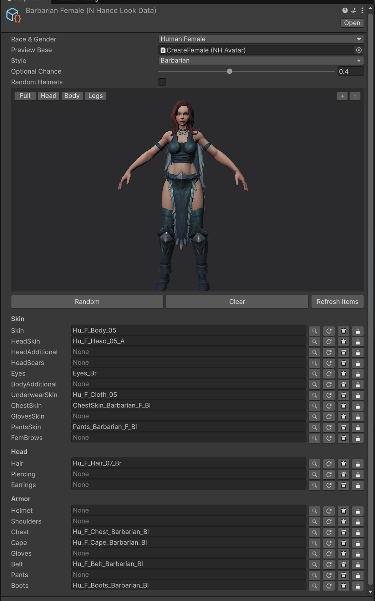

# NHanceCustomization

Describe an N-Hance character’s look in a ScriptableObject: random or hand-picked outfits by style, with a 3D preview and one-call dressing at runtime.

## Overview

A **Character Look** is an asset that holds how one N-Hance Stylized Character looks: its race and gender and one item per slot (skin, hair, eyes, chest, boots, cape...). The Inspector rolls a new look at the press of a button or lets you pick every item by hand, and shows the result on a 3D preview of the character as you go. At run time `NHanceLookApplier` puts the look on a character.

Random builds the outfit the way N-Hance's own presets are made: **one style, one color**, so the pieces always belong together, and it never gives a character holes, a bald head or a helmet that hides the hair (unless you ask for helmets).



## Features

- A ScriptableObject that only holds choices: race and gender, one item prefab per slot, a lock per slot
- **Random** button: the outfit (chest, shoulders, cape, belt, gloves, boots, helmet and the style's skin overlays) comes from one clothing style and one color; skin, head skin and underwear follow each other, hair and brows share a color
- **Style** menu: the styles are read off the item names in your project (Barbarian, Peasant...), so a style pack you import later shows up by itself; *All* picks a style at random each time
- Per slot: a picker, a roll-again button, a clear button and a lock that keeps the slot through Random; drag an item onto a slot to set it
- 3D preview with the look worn: left or right drag turns it, the middle button drags the view, the wheel zooms towards the pointer, + and - zoom to the middle, Full / Head / Body / Legs jump to a part
- An item picker window with thumbnails and search that can be resized and docked
- Items with a missing material (they would leave holes in the character) are skipped by Random and marked in the Inspector and the picker
- Weapons, shields and quivers are not part of a look
- `NHanceLookApplier` dresses the character; `NHanceLookRules.Apply(avatar, look)` does the same from your own code

## Setup

### Requirements

- Unity 2022.3 LTS or newer (made with Unity 6)
- The **N-Hance Stylized Character** asset, with a character prefab whose `NHAvatar` is set up (root bone, geometry, default materials)
- [CombatSystem](https://github.com/fatihgezerx/CombatSystem) for `NHanceLookApplier.cs` only: it implements Combat System's `IFighterAppearance`, so the fighter dresses itself when it is initialized. Without Combat System delete that one file and call `NHanceLookRules.Apply(avatar, look)` yourself; everything else works on its own.

### Installation

Copy the repository into your project's `Assets/` (e.g. `Assets/Scripts/NHanceCustomization`).

N-Hance has no assembly definition, so its code is in `Assembly-CSharp`, which a folder with an assembly definition cannot see. Keep this folder out of any folder that has an `.asmdef`, and do not add one to it.

## Quick Start

1. **Assets > Create > N-Hance > Character Look.**
2. Pick *Race & Gender* and a *Preview Base*: a character prefab with a set-up `NHAvatar` for that race and gender. The look takes the gender of the base.
3. Pick a *Style* (or leave *All*) and press **Random** until you like it; lock the slots you want to keep, or pick items by hand with the magnifier.
4. On the character that has the `NHAvatar`, add **NHanceLookApplier** and assign the look. With Combat System, put it on the Fighter object or a child: the fighter calls it once when it is initialized, before it places its weapons.

From code:

```csharp
applier.Look = otherLook;
applier.Apply();
```

or, without the applier:

```csharp
NHanceCustomization.NHanceLookRules.Apply(avatar, look);
```

## Notes

- A look holds item prefab references, not indexes, so moving or adding assets never shifts a choice.
- Slots a look leaves empty are emptied on the character, so the look is the whole outfit.
- Random never rolls the **Pants** item (it hides the legs and brings a short mesh, which leaves a gap under a long chest piece; N-Hance's presets leave it out and put the trousers on the legs with the style's `PantsSkin`), nor the additional skins (`BodyAdditional`, `HeadAdditional`, `HeadScars`): pick those by hand.
- Random always gives hair, and no helmet unless *Random Helmets* is on, because N-Hance takes the hair off a character that wears one. If the project has no hair item for a race and gender, Random says so in the Console.
- N-Hance's `NHAvatar.Start` reads the Animator's controller without a null check, which would log an error for a character animated by something else (no controller). The applier switches the avatar component off while playing, before that `Start` runs (it only serves N-Hance's animation browser; dressing does not need it), so N-Hance's own code stays untouched.
- Dressing builds the items with N-Hance's `Compile`: a one-time cost per character when it is dressed.
- The Inspector finds the item prefabs once and keeps the list; press **Refresh Items** after you add, remove or fix item prefabs.

## License

[MIT License](LICENSE)
