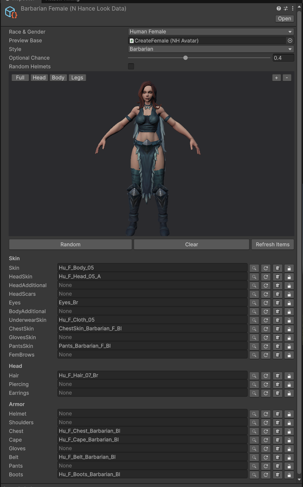

# NHanceCustomization

Describe an N-Hance character’s look in a ScriptableObject: random or hand-picked outfits by style, with a 3D preview and one-call dressing at runtime.

## Overview

A **Character Look** is an asset that holds how one N-Hance Stylized Character looks: its race and gender and one item per slot (skin, hair, eyes, chest, boots, cape...). The Inspector rolls a new look at the press of a button or lets you pick every item by hand, and shows the result on a 3D preview of the character as you go. At run time `NHanceLookApplier` puts the look on a character.

Random builds the outfit the way N-Hance's own presets are made: **one style, one color**, so the pieces always belong together, and it never gives a character holes, a bald head or a helmet that hides the hair (unless you ask for helmets).



## Features

- A ScriptableObject that only holds choices: race and gender, one item prefab per slot, a lock per slot
- **Random** button: the outfit (chest, shoulders, cape, belt, gloves, boots, helmet and the style's skin overlays) comes from one clothing style and one color; skin, head skin and underwear follow each other, hair and brows share a color
- **Style** menu: the styles are read off the item names in your project (Barbarian, Peasant...), so a style pack you import later shows up by itself; *All* picks a style at random each time
- Per slot: a picker, a roll-again button, a clear button and a lock that keeps the slot through Random; drag an item onto a slot to set it
- 3D preview with the look worn: left or right drag turns it, the middle button drags the view, the wheel zooms towards the pointer, + and - zoom to the middle, R resets, Full / Head / Body / Legs jump to a part (with Veneer these are the kit's own buttons and the camera glides to the part; without it, plain IMGUI buttons and the view jumps)
- An item picker window with thumbnails and search that can be resized and docked
- Items with a missing material (they would leave holes in the character) are skipped by Random and marked in the Inspector and the picker
- Weapons, shields and quivers are not part of a look
- `NHanceLookApplier` dresses the character; `NHanceLookRules.Apply(avatar, look)` does the same from your own code
- **Bake**: turn a look, or a prefab dressed earlier, into a lean character without N-Hance's per-item skeleton copies (see below)
- **Create Look From Selected Character**: write an already dressed character down as a Character Look

## In the editor

With the optional **Veneer** installed, a Character Look gets the studio look. A header card shows the title "Character look" and a pill with the number of filled slots (or a warning when the Preview Base does not match the race and gender). The 3D preview sits under it and stays visible on every tab. Three tabs follow:

- **Items**: a *Randomize* card with the Style menu and the **Random** and **Clear** buttons, then one card each for Skin, Head and Armor with one row per slot: the chosen item (click to show the prefab, drop an item of that slot on it), a picker, roll-again, clear and a lock.
- **Character**: Race & Gender and the Preview Base, with the same reset rules as before.
- **Random**: the optional chance, the Random Helmets switch and **Refresh items**.

The Inspector is drawn from a default layout that the system ships (`NHanceLookDataDefaultLayout`) and can be customised in `Tools > Veneer > Inspector Designer` with Customize / Reset. The system's own items (state pill, 3D preview, Style menu, Random and Clear, slot rows, Refresh items) can be moved or hidden there but not changed.

The item picker is a studio window (title bar, search box, size slider, thumbnails); the thumbnail grid is still an IMGUI area inside the new shell. The 3D preview is the kit's `VeneerModelPreview` (the scene and the dressed character come from `NHanceLookPreviewSource`; the Style picker is the kit's animated dropdown). Keyboard while the preview has focus: arrows turn (Shift pans, Up / Down zoom), + / - zoom, Home resets. The studio look needs Veneer; without it the Inspector and the picker fall back to the plain IMGUI versions that have the same features. `Editor/Setup` holds a tiny reference-free assembly with a dependency guard that detects the kit, sets `HAS_VENEER` and offers to download it. N-Hance has no assembly definition, so the editor code stays in the project's editor assembly and is switched by `#if HAS_VENEER`.

## Setup

### Requirements

- Unity 2022.3 LTS or newer (made with Unity 6)
- The **N-Hance Stylized Character** asset, with a character prefab whose `NHAvatar` is set up (root bone, geometry, default materials)
- Optional: [CombatSystem](https://github.com/fatihgezerx/CombatSystem). With it (`HAS_COMBAT_SYSTEM`) `NHanceLookApplier` implements Combat System's `IFighterAppearance`, so the fighter dresses itself when it is initialized. Without it the applier dresses the character in `Start`.

### Installation

Copy the repository into your project's `Assets/` (e.g. `Assets/Scripts/NHanceCustomization`).

N-Hance has no assembly definition, so its code is in `Assembly-CSharp`, which a folder with an assembly definition cannot see. Keep this folder out of any folder that has an `.asmdef`, and do not add one to it (the only one is the reference-free `Editor/Setup/NHanceCustomization.Setup.asmdef` of the dependency guard).

## Quick Start

1. **Assets > Create > N-Hance > Character Look.**
2. Pick *Race & Gender* and a *Preview Base*: a character prefab with a set-up `NHAvatar` for that race and gender. The look takes the gender of the base.
3. Pick a *Style* (or leave *All*) and press **Random** until you like it; lock the slots you want to keep, or pick items by hand with the magnifier.
4. On the character that has the `NHAvatar`, add **NHanceLookApplier** and assign the look. With Combat System, put it on the Fighter object or a child: the fighter calls it once when it is initialized, before it places its weapons.

From code:

```csharp
applier.Look = otherLook;
applier.Apply();
```

or, without the applier:

```csharp
NHanceCustomization.NHanceLookRules.Apply(avatar, look);
```

## Bake

Every equipment item N-Hance builds is a copy of the item prefab with **its own full skeleton** and an `Equipment` component. When the character spawns, `Equipment.Start` moves the item's renderers onto the character's bones and leaves the copy behind: a dressed character easily carries 1,000-2,500 transforms, most of them unused, and redoes that work on every spawn.

Baking does the move once in the editor - the same bone lookup and the same `updateWhenOffscreen` as `Equipment` - then deletes the skeleton copies and the `Equipment` components. The character looks and animates the same.

- **Bake Selected Prefabs** (*Tools > N-Hance Customization*): bakes the selected prefabs in place (same files and GUIDs, so nothing that points at them breaks). Base prefabs are baked before their variants; an item a variant inherits is baked through its base prefab.
- **Bake to Prefab...** (the Character Look's context menu, or *Assets > N-Hance > Bake Look to Prefab...*): dresses a copy of the Preview Base and saves the baked character as a new plain prefab, without `NHAvatar` / `NHItem` / `Equipment`.
- From code: `NHanceBake.BakePrefabs(paths)`, `NHanceBake.BakeLookToPrefab(look, path)`, `NHanceBake.Bake(root, stripNHanceComponents)`.

What is never touched: a copy transform that holds a component (a trail, an effect...) or that any component of the character refers to (an IK or rig component's setup pose, say) is kept with its parents, and no reference is redirected. Renderers that `Equipment` would not fit either (on an inactive child) keep their bones. Each bake returns a report of what it did and what it left.

**Create Look From Selected Character** (*Tools > N-Hance Customization*) goes the other way: it writes a dressed character down as a Character Look, from its `NHAvatar` when it has one, otherwise by finding each item by its name and the skin, head skin, eyes and brows by their materials on the body. The item prefabs have to be in the project.

## Notes

- A look holds item prefab references, not indexes, so moving or adding assets never shifts a choice.
- Slots a look leaves empty are emptied on the character, so the look is the whole outfit.
- Random never rolls the **Pants** item (it hides the legs and brings a short mesh, which leaves a gap under a long chest piece; N-Hance's presets leave it out and put the trousers on the legs with the style's `PantsSkin`), nor the additional skins (`BodyAdditional`, `HeadAdditional`, `HeadScars`): pick those by hand.
- Random always gives hair, and no helmet unless *Random Helmets* is on, because N-Hance takes the hair off a character that wears one. If the project has no hair item for a race and gender, Random says so in the Console.
- N-Hance's `NHAvatar.Start` reads the Animator's controller without a null check, which would log an error for a character animated by something else (no controller). The applier switches the avatar component off while playing, before that `Start` runs (it only serves N-Hance's animation browser; dressing does not need it), so N-Hance's own code stays untouched.
- Dressing builds the items with N-Hance's `Compile`: a one-time cost per character when it is dressed.
- The Inspector finds the item prefabs once and keeps the list; press **Refresh Items** after you add, remove or fix item prefabs.

## License

[MIT License](LICENSE)
